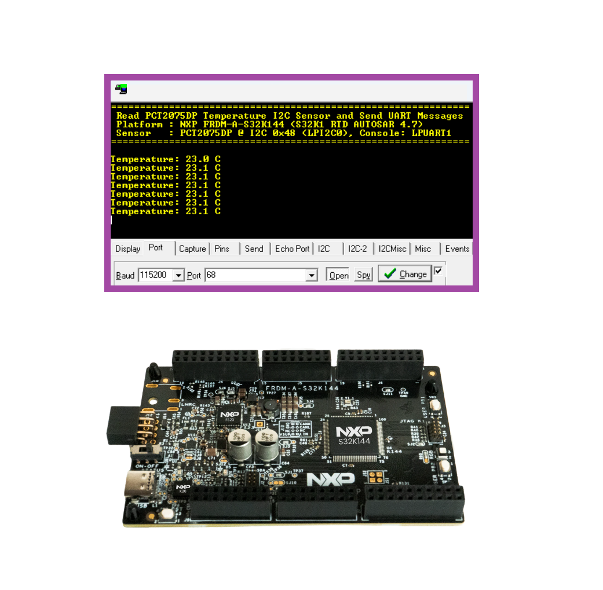
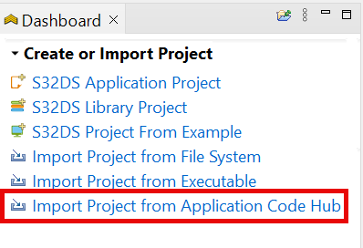
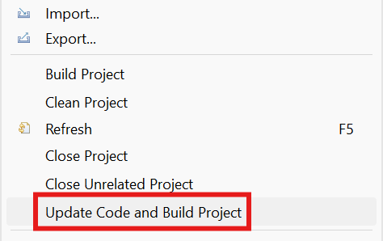
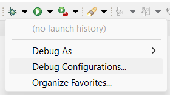

# NXP Application Code Hub
[](https://www.nxp.com)

## PCT2075DP I2C Temperature Reading with UART Output

This demo shows how to read the [PCT2075DP](https://www.nxp.com/products/PCT2075) I2C temperature sensor on the FRDM-A-S32K144 board and stream the measured temperature to a USB-UART serial console once per second.

The application uses the S32K1 RTD (Real-Time Drivers, AUTOSAR 4.7) `Lpi2c_Ip` blocking master API to communicate with the sensor, and the `Lpuart_Uart_Ip` driver for the serial console. The PCT2075DP register map and temperature-conversion logic were ported from the MCUXpresso ISSDK PCT2075DP driver.

[<p align="center"></p>](./images/FRDM-A-S32K144_I2C_Temp_UART.png)

#### Boards: FRDM-A-S32K144
#### Categories: Low Power, Sensor
#### Peripherals: GPIO, I2C, UART
#### Toolchains: S32 Design Studio IDE

## Table of Contents
1. [Software and Tools](#step1)
2. [Hardware](#step2)
3. [Setup](#step3)
4. [Results](#step4)
5. [Support](#step5)
6. [Release Notes](#step6)

## 1. Software and Tools<a name="step1"></a>

This example was developed using the FRDM Automotive Bundle for S32K1. To download and install the complete software and tools ecosystem, use the following link:
- [S32K1 FRDM Automotive Board Installation Package](https://www.nxp.com/app-autopackagemgr/automotive-software-package-manager:AUTO-SW-PACKAGE-MANAGER?currentTab=0&selectedDevices=S32K1&applicationVersionID=155)

## 2. Hardware<a name="step2"></a>

### 2.1 Required Hardware
- Personal Computer
- Type-C USB cable
- [FRDM-A-S32K144](https://www.nxp.com/design/design-center/development-boards-and-designs/FRDM-A-S32K144)
[<p align="center"></p>](https://www.nxp.com/assets/images/en/dev-board-image/FRDM-A-S32K144-TOP.png)

### 2.2 Board Pin Mapping

| Signal      | MCU Pin | Direction | Notes                              |
|-------------|---------|-----------|------------------------------------|
| LPI2C0 SCL  | PTA3    | Output    | I2C Clock to PCT2075DP (100 kHz)   |
| LPI2C0 SDA  | PTA2    | Bidir     | I2C Data  to PCT2075DP             |
| LPUART1 RX  | PTC6    | Input     | USB-UART console                   |
| LPUART1 TX  | PTC7    | Output    | USB-UART console                   |
| LED Blue    | PTB12   | Output    | Sample heartbeat                   |
| LED Green   | PTB13   | Output    | (unused, driven off)               |
| LED Red     | PTE7    | Output    | (unused, driven off)               |

LEDs are active-high. Confirm the LPI2C0 SCL/SDA pin assignment in the S32 Configuration Tool (Pins) for your wiring.

### 2.3 I2C Configuration
- **Bus**: LPI2C0, Standard mode, 100 kHz
- **PCT2075DP 7-bit address**: `0x48` (A2/A1/A0 tied low; the device supports the range `0x48`-`0x4F`)

### 2.4 Debugger Connection
- Connect the USB cable to the PC and the FRDM-A-S32K144 board for power supply and debugging.

## 3. Setup<a name="step3"></a>

### 3.1 Import the Project into S32 Design Studio IDE
1. Open S32 Design Studio IDE, in the Dashboard Panel, choose **Import project from Application Code Hub**.
   [<p align="center"></p>](./images/import_project_1.png)

2. Find the demo by searching: [PCT2075DP I2C Temperature Reading with UART Output](https://mcuxpresso.nxp.com/appcodehub?search=dm-i2c-temperature-uart-s32k144)

3. Open the project, click the **GitHub link**, S32 Design Studio IDE will automatically retrieve project attributes, then click **Next>**.
    [<p align="center"></p>](./images/import_project_3.png)

4. Select **main** branch and then click **Next>**.

5. Select your local path for the repo in **Destination->Directory:** window. The S32 Design Studio IDE will clone the repo into this path, click **Next>**.

6. Select **Import existing Eclipse projects** then click **Next>**.

7. Select the project in this repo (only one project in this repo) then click **Finish**.

### 3.2 Generating, Building and Running the Example
1. In Project Explorer, right-click the project and select **Update Code and Build Project**. This will generate the configuration (Pins, Clocks, Peripherals), update the source code and build the project using the active configuration (e.g. Debug_FLASH).
Make sure the build completes successfully and the *.elf file is generated without errors.
[<p align="center"></p>](./images/update_and_build.png)
Press **Yes** in the **SDK Component Management** pop-up window to continue.

2. Go to **Debug** and select **Debug Configurations**. There will be a debug configuration for this project:
[<p align="center"></p>](./images/Debug_config.png)

        Configuration Name                  Description
        -------------------------------     -----------------------
        $(example)_debug_flash_pemicro      Debug the FLASH configuration using PEmicro probe

    Select the desired debug configuration and click on **Debug**. Now the perspective will change to the **Debug Perspective**.
3. The IDE switches to the Debug perspective. Use the Run/Resume control to start execution.

## 4. Results<a name="step4"></a>

Open a serial terminal on the enumerated COM port with the following settings:

| Parameter  | Value  |
|------------|--------|
| Baud rate  | 115200 |
| Data bits  | 8      |
| Parity     | None   |
| Stop bits  | 1      |
| Flow ctrl  | None   |

After reset, the board prints the welcome banner once, then streams the temperature reading once per second:

```
==============================================================
 Read PCT2075DP Temperature I2C Sensor and Send UART Messages
 Platform : NXP FRDM-A-S32K144 (S32K1 RTD AUTOSAR 4.7)
 Sensor   : PCT2075DP @ I2C 0x48 (LPI2C0), Console: LPUART1
==============================================================

Temperature: 23.0 C
Temperature: 23.1 C
Temperature: 23.1 C
...
```

### Application Behavior

- On startup, LPI2C0 (100 kHz), LPUART1, and the PCT2075DP driver are initialized and the banner is printed once.
- Every ~1 second the firmware reads the PCT2075DP `TEMP` register (2 bytes), converts it to degrees Celsius (0.125 C/LSB, with sign handling), and prints it over UART.
- The temperature is printed as `whole.tenths` (one decimal) using integer math, so `%f` support in the C library is not required.
- The **blue LED (PTB12)** blinks briefly on each sample as a heartbeat / activity indicator.
- If an I2C transfer fails, the firmware prints `Temperature read failed (I2C error)` instead of a value.

### Source Files of Interest

| File            | Purpose                                                             |
|-----------------|---------------------------------------------------------------------|
| `src/main.c`    | Application entry point, init sequence, and 1 Hz temperature stream |
|`src/pct2075dp.h`| PCT2075DP register map, conversion constants, and public API        |
|`src/pct2075dp.c`| PCT2075DP driver over the RTD `Lpi2c_Ip` blocking master API        |

## 5. Support<a name="step5"></a>

For general technical questions related to NXP microcontrollers, please use the *NXP Community Forum*.

#### Project Metadata

<!----- Boards ----->
[](https://mcuxpresso.nxp.com/appcodehub?hwBoard=FRDM-A-S32K144)

<!----- Categories ----->
[](https://mcuxpresso.nxp.com/appcodehub?category=low_power)
[](https://mcuxpresso.nxp.com/appcodehub?category=sensor)

<!----- Peripherals ----->
[](https://mcuxpresso.nxp.com/appcodehub?peripheral=gpio)
[](https://mcuxpresso.nxp.com/appcodehub?peripheral=i2c)
[](https://mcuxpresso.nxp.com/appcodehub?peripheral=uart)

<!----- Toolchains ----->
[](https://mcuxpresso.nxp.com/appcodehub?toolchain=s32_design_studio_ide)

Questions regarding the content/correctness of this example can be entered as Issues within this GitHub repository.

>**Note**: For more general technical questions regarding NXP Microcontrollers and the difference in expected functionality, enter your questions on the [NXP Community Forum](https://community.nxp.com/)

[](https://www.youtube.com/NXP_Semiconductors)
[](https://www.linkedin.com/company/nxp-semiconductors)
[](https://www.facebook.com/nxpsemi/)
[](https://x.com/NXP)

## 6. Release Notes<a name="step6"></a>

| Version | Description / Update                           | Date                          |
|:-------:|------------------------------------------------|------------------------------:|
| 1.0     | Initial release on Application Code Hub        | November 19<sup>th</sup> 2026 |
